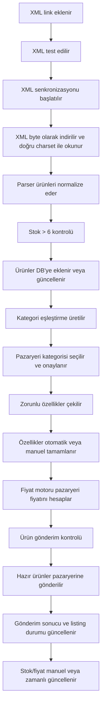
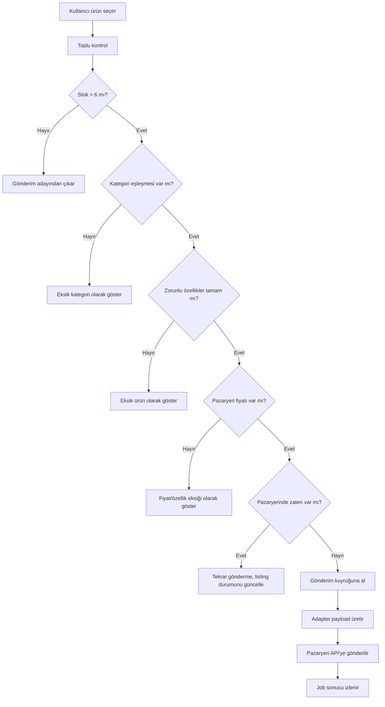

# Pazario Uygulama Algoritması ve İş Akışı

Bu doküman uygulamanın işleyişini takip etmek, eksik adımları görmek ve yeni düzenlemeleri doğru noktaya yapmak için hazırlanmıştır.

## 1. Sistem Amacı

Pazario, XML tedarikçi linklerinden ürünleri alır, normalize eder, fiyatlandırır, kategori ve zorunlu özellik kontrollerinden geçirir, pazaryerlerine gönderir, pazaryerindeki mevcut ürünleri takip eder, stok/fiyat günceller ve sipariş/finans durumunu izler.

Desteklenen ana pazaryerleri:

- Trendyol
- N11
- Pazarama
- Hepsiburada, şu an bazı akışlarda devre dışı veya kısıtlıdır

## 2. Ana Modüller

| Modül | Görev | Ana Dosyalar |
|---|---|---|
| XML Kaynakları | XML link ekleme, test, senkronizasyon | `source.controller.ts`, `xmlFetch.ts`, `MarketplacePipeline.ts` |
| XML Parser | XML ürünlerini standart ürün formatına çevirme | `XMLParser.ts` |
| Ürünler | Ürün listeleme, filtreleme, gönderim kontrolü, sosyal medya gönderimi | `product.controller.ts`, `ProductsPage.tsx` |
| Fiyat Motoru | Pazaryeri fiyatını hesaplama | `PriceEngine.ts`, `price.controller.ts`, `PriceEnginePage.tsx` |
| Kategori Eşleştirme | XML kategorisini pazaryeri kategorisine bağlama | `category.controller.ts`, `CategoryPage.tsx` |
| Zorunlu Özellikler | Pazaryeri özelliklerini çekme, ürün özelliklerini doldurma | `CategoryAttributeService.ts`, `attributes.controller.ts` |
| Ürün Gönderimi | Hazır ürünleri pazaryerine gönderme ve sonucu izleme | `PublishService.ts`, adapter dosyaları |
| Pazaryeri Ürünleri | Pazaryerinde mevcut ürünleri içeri alma, eşleştirme, stok/fiyat güncelleme | `marketplace.controller.ts`, `MarketplacesPage.tsx` |
| Sipariş | Pazaryerlerinden sipariş çekme, kaynak tespiti, durum yönetimi | `OrderFetchService.ts`, `OrderStateMachine.ts` |
| Finans | Sipariş kalemi bazında satış, kargo, hizmet ve ek ücretleri izleme | `finance.controller.ts`, `FinancePage.tsx` |

## 3. Genel İş Akışı



## 4. XML Kaynak Algoritması

### 4.1 XML Link Ekleme

1. Kullanıcı XML linkini Kaynaklar sayfasından ekler.
2. Sistem `xml_sources` tablosuna kayıt açar.
3. Kaynak aktif olarak işaretlenir.

### 4.2 XML Test

1. Backend XML'i `fetchXml` ile indirir.
2. XML düz metin olarak değil, byte olarak alınır.
3. Karakter seti şu sırayla belirlenir:
   - HTTP `Content-Type` içindeki `charset`
   - XML declaration içindeki `encoding`
   - `utf-8`, `windows-1254`, `iso-8859-9`, `iso-8859-1` denemeleri
4. XML boş, HTML hata sayfası veya yetkisiz cevap ise test başarısız olur.
5. Parser ilk ürün örneklerini ve toplam sayıyı döndürür.

### 4.3 XML Senkronizasyon

1. `sync_jobs` tablosuna `PENDING` iş kaydı açılır.
2. İş `RUNNING` yapılır.
3. XML indirilir ve parse edilir.
4. Ürünler `externalId` ile mevcut ürünlerle karşılaştırılır.
5. `contentHash` farklıysa güncelleme yapılır.
6. XML'de artık olmayan ürünler stok `0` yapılır.
7. İş başarılıysa `DONE`, hata varsa `FAILED` olur.

## 5. Ürün Kabul Kuralları

Temel ürün kuralları:

- Ürün stok miktarı `> 6` değilse pazaryerine gönderilmez.
- Stok yetersiz ürünler gönderim ekranında kafa karıştırmaması için gönderim adaylarına dahil edilmemelidir.
- Ürün fiyatı doğrudan kullanılmaz; pazaryeri gönderiminde her zaman hesaplanmış pazaryeri fiyatı kullanılır.
- Hesaplanmış pazaryeri fiyatı yoksa ürün gönderilemez veya stok `0` kabul edilir.
- Gönderim sırasında marka adı `Berselya Underwear&Accessoires` olarak dönüştürülür.
- Gönderim sırasında barkod başına `BRS` eklenir.
- Bu dönüşümler DB'deki orijinal ürünü bozmaz; sadece pazaryeri payload aşamasında uygulanır.

## 6. Fiyat Motoru Algoritması

Fiyat motoru her pazaryeri için ayrı hesap yapar.

### 6.1 Girdi

- XML fiyatı, özellikle XML Tedarik kaynaklarında `ListPrice`
- Pazaryeri
- Kategori, marka veya ürün kapsamı
- Fiyat aralığı
- Ek tutar
- Kar marjı
- Kargo
- Komisyon oranı
- Global minimum fiyat

### 6.2 Kural Seçimi

1. Aktif kurallar alınır.
2. Pazaryeri eşleşir.
3. Fiyat aralığı kontrol edilir:
   - `priceStart <= basePrice`
   - `basePrice <= priceEnd`
4. Kapsam önceliği değerlendirilir:
   - PRODUCT
   - BRAND
   - CATEGORY
   - MARKETPLACE
   - GLOBAL
5. Öncelik değeri ile en uygun kural seçilir.

### 6.3 Hesap

Genel mantık:

```text
basePrice = XML fiyatı
ara1 = basePrice + ekTutar
ara2 = ara1 * karOrani
ara3 = ara2 + kargo
rawPrice = ara3 / (1 - komisyonOrani)
finalPrice = max(rawPrice, globalMinPrice)
```

Notlar:

- Kar oranı kullanıcı `%35` girerse sistem bunu `1.35` çarpanına çevirmelidir.
- Komisyon oranı `0.25` ise `%25` anlamına gelir.
- Final fiyat audit için `price_calculations` tablosuna yazılır.

## 7. Kategori Eşleştirme Algoritması

### 7.1 Eşleştirme Üretimi

1. `products` tablosundan kaynak kategoriler alınır.
2. Sadece `stock > 6` olan ürünlerin kategorileri dikkate alınır.
3. Her kaynak kategori ve pazaryeri için `category_mappings` kaydı oluşturulur.
4. Duplicate kayıtlar atlanır.

### 7.2 Pazaryeri Kategori Ağacı

1. Pazaryeri kategori API'sinden kategori ağacı alınır.
2. Leaf, yani son kırılım kategoriler `marketplace_categories` tablosuna yazılır.
3. Kullanıcı manuel eşleştirmede sadece son kırılım seçmelidir.

### 7.3 Öneri Algoritması

1. Kaynak kategori normalize edilir.
2. Kelimeler ayrıştırılır.
3. Pazaryeri kategori yollarında benzer kelimeler aranır.
4. İç giyim, takı, elektronik gibi domain kontrolleri yapılır.
5. En yüksek skorlu 3 öneri saklanır.
6. Kullanıcı öneriyi onaylar veya manuel kategori seçer.

### 7.4 Eşleşme Düzeltme

1. Onaylı eşleşmenin yanında Düzenle butonu bulunur.
2. Kullanıcı eşleşmeyi tekrar `PENDING` duruma alabilir.
3. Yeni kategori seçilip tekrar onaylanır.
4. Onaydan sonra zorunlu özellikler yeniden çekilir.

## 8. Zorunlu Özellik Algoritması

### 8.1 Özellik Çekme

1. Kategori onaylanınca ilgili pazaryeri kategori özellikleri API'den alınır.
2. `marketplace_category_attributes` tablosuna yazılır.
3. Zorunlu alanlar ürün gönderim kontrolünde kullanılır.

### 8.2 Otomatik Tamamlama

Öncelik sırası:

1. XML'den gelen renk ve beden bilgisi
2. Ürün adı ve kategori metni
3. Sabit varsayılanlar
4. Kullanıcı manuel girişi

İç giyim ürünleri için:

- Renk XML'den alınır.
- Beden XML'den alınır.
- Cinsiyet ürün adında `Kadın` veya kategori kadın giyim ise `Kadın` atanabilir.
- Yaş grubu çoğunlukla `Yetişkin` atanabilir.

Kural:

- Kullanıcı zorunlu alanları doldursa bile renk ve beden için XML verisi varsa gönderimde XML değeri önceliklidir.

## 9. Ürün Gönderim Algoritması



### 9.1 Hazır Ürün Kriteri

Bir ürünün gönderime hazır olması için:

- Stok `> 6`
- Kategori eşleşmesi `APPROVED`
- Zorunlu özellikler tamam
- Hesaplanmış pazaryeri fiyatı var
- Pazaryerinde zaten yayında değil
- Görsel, SKU, barkod ve başlık kurallara uygun

### 9.2 Gönderim Payload Dönüşümü

Gönderim anında:

- Marka pazaryeri payload içinde `Berselya Underwear&Accessoires` yapılır.
- Barkod `BRS` prefix ile gönderilir.
- Renk ve beden XML varyant bilgisinden alınır.
- Pazaryeri fiyatı `PriceEngine` sonucundan alınır.
- Ürün orijinal DB kaydı değiştirilmez.

## 10. Varyant Algoritması

Bir ürün XML'de birden fazla beden veya renk ile geliyorsa:

1. Aynı model kodu veya ürün kodu varyant grubu kabul edilir.
2. Her beden/renk ayrı barkod/SKU ile ürün varyantı olmalıdır.
3. Pazaryerine gönderimde:
   - Ana ürün başlığı ortak tutulur.
   - Beden ve renk ayrı varyant özellikleri olarak gönderilir.
   - Var olmayan beden gönderilmez.
   - XML'de olan tüm geçerli bedenler gönderilir.
4. Stok her varyant için ayrı takip edilir.

Kontrol edilmesi gereken kritik alanlar:

- XML parser varyantları ayrı ürün olarak mı çıkarıyor?
- Pazaryeri adapter payload içinde varyant gruplama doğru mu?
- Trendyol için aynı `modelCode` altında farklı barkodlar gönderiliyor mu?

## 11. Pazaryeri Mevcut Ürünleri Algoritması

### 11.1 İçeri Alma

1. Kullanıcı pazaryeri seçer.
2. Sistem pazaryeri ürün listeleme API'sinden ürünleri çeker.
3. DB ürünleriyle eşleşme yapılır:
   - Barkod
   - SKU
   - Model kodu
   - Başlık fallback
4. Eşleşenler `marketplace_listings` tablosuna yazılır.
5. Eşleşmeyenler ayrıca listelenir.

### 11.2 Durum Renkleri

Ürünler sayfasındaki pazaryeri kısa adları:

- Yeşil: ürün pazaryerinde yüklü/yayında
- Sarı: onay sürecinde veya gönderim kuyruğunda
- Kırmızı: yüklenmedi veya hata aldı
- Gri: durum bilinmiyor veya kontrol edilmedi

### 11.3 Tekrar Gönderimi Önleme

Ürün daha önce pazaryerinde yayında ise:

- Tekrar ürün oluşturma yapılmaz.
- Sadece stok/fiyat güncelleme akışına alınır.
- `hashAtPublish` aynı ise gereksiz gönderim atlanır.

## 12. Stok ve Fiyat Güncelleme Algoritması

Üç manuel işlem vardır:

- Stok Güncelle
- Fiyat Güncelle
- Stok ve Fiyat Güncelle

Zamanlı işlem için:

1. Her pazaryeri için `marketplace_sync_settings` kaydı bulunur.
2. `enabled = true` ise zaman kontrol edilir.
3. `scheduleTime` geldiğinde seçilen mod çalışır.
4. Limit kadar listing işlenir.
5. Pazaryeri API ile stok/fiyat gönderilir.
6. `lastRunAt` güncellenir.

Fiyat güncellemede her zaman hesaplanmış pazaryeri fiyatı kullanılır.

## 13. Sipariş ve Tedarikçi Kaynak Tespiti

Sipariş geldiğinde ürünün hangi XML firmasından geldiği şu sırayla bulunur:

1. Sipariş kalemindeki barkod veya SKU alınır.
2. `products` tablosunda barkod/SKU eşleşmesi aranır.
3. Ürün bulunursa `sourceId` üzerinden XML kaynağı bulunur.
4. `order_items.sourceId` alanına kaynak yazılır.
5. Finans ekranında ürün bazında tedarikçi bilgisi gösterilebilir.

Bu yapı sipariş sonrası şu soruları cevaplar:

- Ürün hangi XML kaynağından geldi?
- Satış fiyatı neydi?
- Kargo bedeli ne kadar?
- Hizmet bedeli ne kadar?
- Ek ücretler ne kadar?
- Günlük/haftalık/aylık ciro ve gider toplamı ne?

## 14. Finans Algoritması

### 14.1 Ürün Bazında Finans

Her sipariş kalemi için:

- Satış fiyatı
- Adet
- Toplam satış
- Kargo bedeli
- Hizmet bedeli
- Ek ücretler
- Kaynak XML firması
- Pazaryeri

### 14.2 Özetler

Finans sayfası şu dönemleri hesaplar:

- Günlük
- Haftalık
- Aylık

Temel hesap:

```text
brutSatis = order_items.totalPrice toplamı
kargo = shippingFee toplamı
hizmet = serviceFee toplamı
ekUcret = extraFees toplamı
net = brutSatis - kargo - hizmet - ekUcret
```

## 15. Sosyal Medya Make.com Akışı

1. Ürünler sayfasında Sosyal Medya butonu kullanılır.
2. Backend Make webhook'a ürün verisini gönderir.
3. Payload içinde en az şu alanlar olmalıdır:
   - title
   - category
   - brand
   - image
   - price
   - product_url
4. Make tarafında `category` değerine göre router çalışır:
   - Takı kategorisi ise takı SEO prompt'u
   - İç giyim kategorisi ise iç giyim SEO prompt'u
5. Groq JSON üretir.
6. JSON parse edilir.
7. Pinterest ve Instagram modüllerine gönderilir.

## 16. Hata Yönetimi

| Hata | Olası Neden | Çözüm Noktası |
|---|---|---|
| Türkçe karakter bozuk | XML yanlış encoding ile okunmuş | `xmlFetch.ts` |
| Ürün görünmüyor | Stok `<= 6`, kaynak pasif, filtre açık | Ürün filtreleri ve XML sync |
| Kategori görünmüyor | Kategori üretimi stok filtresine takılmış olabilir | Kategori eşleştirme üretimi |
| Pazarama import başarısız | Token/API bilgisi, barkod eşleşmesi | `marketplace.controller.ts` |
| Fiyat yok | Fiyat kuralı aralığı eşleşmiyor | Fiyat motoru |
| Ürün gönderilemiyor | Kategori/özellik/fiyat/listing sorunu | Toplu kontrol modalı |
| Varyant eksik | XML parser veya adapter varyant gruplaması eksik | Parser ve adapter payload |

## 17. Geliştirme Öncelik Sırası

Yeni düzenleme yapılırken önerilen sıra:

1. XML kaynak ve parser doğruluğu
2. Stok `> 6` ürün görünürlüğü
3. Fiyat motoru ve pazaryeri fiyatı
4. Kategori eşleştirme
5. Zorunlu özellikler
6. Varyant gruplama
7. Pazaryeri mevcut ürün importu
8. Ürün gönderim kuyruğu
9. Stok/fiyat güncelleme
10. Sipariş ve finans

## 18. Kritik Karar Kuralları

- DB'deki ürün bilgisi tedarikçi XML'in ham ve normalize edilmiş halidir.
- Pazaryerine özel marka/barkod/fiyat dönüşümleri DB'yi değiştirmeden gönderim anında yapılır.
- Stok `<= 6` ürünler gönderim adayı değildir.
- Kategori eşleştirme stok `> 6` ürünlerden üretilmelidir.
- Pazaryeri fiyatı yoksa ürün fiyatı fallback olarak kullanılmamalıdır.
- Renk ve beden için XML bilgisi kullanıcı girişinden önceliklidir.
- Pazaryerinde zaten olan ürün tekrar ürün ekleme akışına girmemelidir; stok/fiyat güncelleme akışına girmelidir.

